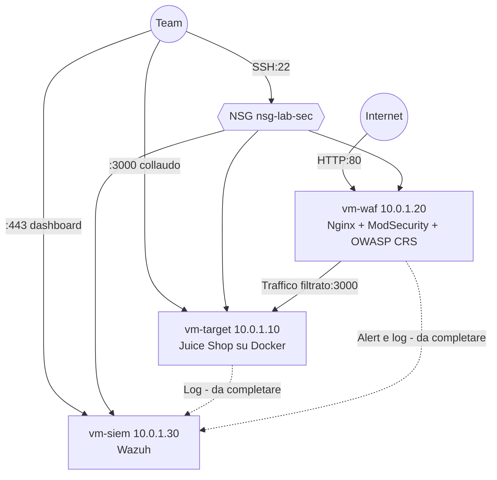

# Architettura del Sistema

## Architettura di Rete e Flusso dei Dati

L'ambiente è distribuito all'interno di una singola sottoscrizione Microsoft Azure, isolato all'interno di una Virtual Network (VNet) dedicata che garantisce il confinamento del traffico. L'infrastruttura di rete è composta da una Subnet (`10.0.1.0/24`) protetta da un Network Security Group. Ogni VM ha un IP pubblico: lo si usa per l'amministrazione, consentita solo dagli indirizzi del team, e per il traffico in uscita. Non ci sono NAT Gateway né Application Gateway. Il traffico web degli utenti esterni è ammesso solo verso il nodo WAF (Reverse Proxy), che inoltra le richieste legittime al target e blocca i tentativi di exploit e injection; la porta 3000 del target è raggiungibile direttamente solo dagli indirizzi del team, per il collaudo. I log delle componenti sono destinati al nodo SIEM centralizzato per la detection (l'inoltro tramite agente è ancora da completare, vedi README).

## Componenti IaaS e Ruoli delle Macchine Virtuali

L'infrastruttura di calcolo si poggia su tre Macchine Virtuali Ubuntu Server, di cui è stato effettuato il provisioning con Terraform e la configurazione tramite Ansible:

* **Target Web App (Juice Shop):** L'ambiente deliberatamente vulnerabile. Questa VM ospita l'applicazione OWASP Juice Shop, eseguita in isolamento tramite container Docker. Rappresenta la superficie di attacco principale per il Red Team, destinata a subire analisi di vulnerabilità, tentativi di accesso non autorizzato ed exploit mirati al form di login per ottenere privilegi di admin.
* **WAF (Nodo di Difesa Perimetrale):** Questa VM agisce come Reverse Proxy a protezione diretta della Web App. Equipaggiata con ModSecurity e integrata con l'OWASP Core Rule Set (CRS), ha il compito di identificare, loggare e bloccare il traffico malevolo e le injection, mitigando le vulnerabilità del target e rendendo inefficaci gli attacchi.
* **SIEM (Nodo di Monitoring e Detection):** Il centro operativo SOC dell'infrastruttura. Questa VM esegue Wazuh con lo scopo di raccogliere e aggregare i log provenienti dal WAF e dalla Web App. Attraverso regole di detection e dashboard dedicate, registra attivamente gli alert di sicurezza e traccia in modo trasparente l'attività offensiva.

### Schema Visivo




## Guida a Deploy e Configurazione

L'infrastruttura è completamente definita come codice (IaC) e il suo rilascio è automatizzato. Di seguito i passaggi operativi per il deploy:

**1. Autenticazione e Setup Iniziale**
Assicurarsi di avere Azure CLI installato e configurato, quindi autenticarsi sulla propria sottoscrizione:
`az login`

**2. Provisioning dell'Infrastruttura (Terraform)**
Compilare `terraform/terraform.tfvars` partendo da `terraform.tfvars.example` (chiave pubblica SSH e IP del team), poi:

```bash
cd terraform
terraform init
terraform apply
terraform output vm_public_ips
```

**3. Configurazione dei Servizi (Ansible)**
Inserire in `ansible/inventory.ini` gli IP pubblici appena ottenuti, poi:

```bash
cd../ansible
ansible-galaxy collection install -r requirements.yml
ansible-playbook -i inventory.ini site.yml
```

## Documentazione di Sicurezza e Mitigazione

L'infrastruttura è stata progettata applicando i principi del DevSecOps e della difesa in profondità (Defense in Depth) per mitigare le vulnerabilità intrinseche del target:

* **Isolamento e Sicurezza di Rete:** Le risorse di calcolo sono confinate in una Virtual Network (VNet) con Subnet dedicata. L'accesso dall'esterno è filtrato dal Network Security Group: da Internet è raggiungibile solo la porta 80 del nodo WAF, mentre SSH, la porta 3000 del target e la dashboard Wazuh sono aperte solo agli indirizzi del team.
* **Mitigazione Applicativa (WAF):** Il nodo ModSecurity opera come Reverse Proxy sfruttando l'OWASP Core Rule Set (CRS). Il suo scopo è intercettare e scartare payload malevoli prima che raggiungano la web app, neutralizzando tentativi di SQL Injection sul form di login, anomalie di input e attacchi legati alla gestione dei token di sessione (BOLA). Questo livello rende l'exploit admin non sfruttabile dall'esterno.
* **Rilevamento e Risposta (SIEM):** Wazuh accentra la telemetria di sicurezza. Raccogliendo i log applicativi di Juice Shop, i log di sistema di Ubuntu Server e gli alert generati da ModSecurity, il SIEM garantisce tracciabilità totale degli eventi. Grazie alle dashboard e alle regole di detection, il team di difesa è in grado di identificare le risorse compromesse, rilevare eventuali file malevoli rilasciati durante gli attacchi e avviare procedure di bonifica mirate.
