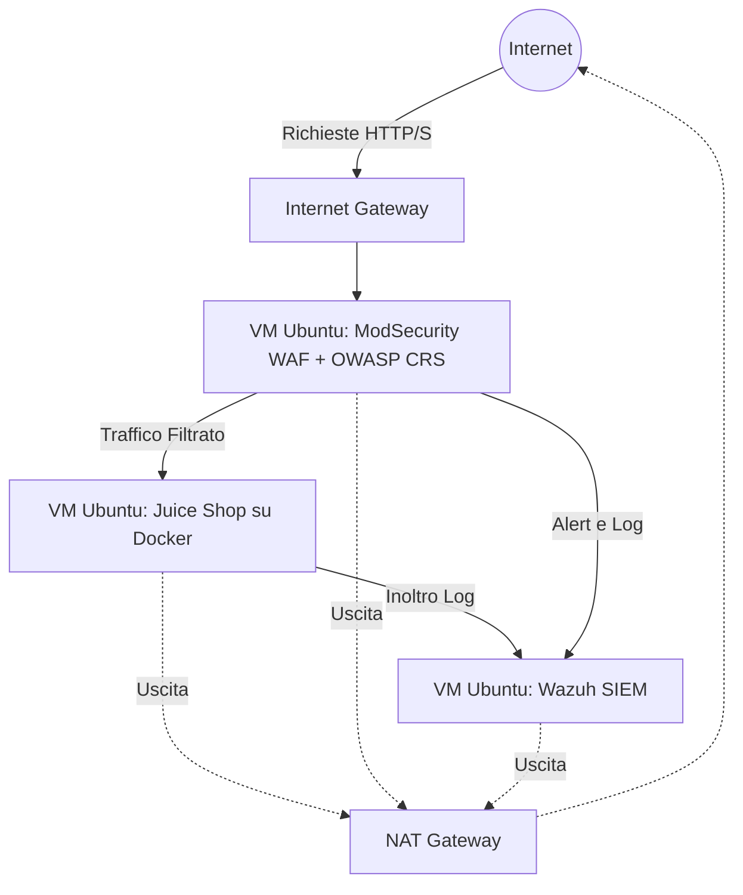

# Architettura del Sistema

## Architettura di Rete e Flusso dei Dati

L'ambiente è distribuito all'interno di una singola sottoscrizione Microsoft Azure, isolato all'interno di una Virtual Network (VNet) dedicata che garantisce il confinamento del traffico. L'infrastruttura di rete è composta da una Subnet privata, protetta a livello di routing e in grado di comunicare con l'esterno tramite un NAT Gateway per il traffico in uscita e un Internet Gateway per l'accesso controllato in entrata. Il traffico web proveniente dagli utenti esterni non raggiunge mai direttamente l'applicativo vulnerabile: viene intercettato e filtrato preventivamente dal nodo WAF (Reverse Proxy), che inoltra le richieste legittime al target bloccando i tentativi di exploit e injection. Parallelamente, tutto il traffico di logging generato dalle componenti viene instradato dinamicamente al nodo SIEM centralizzato per la detection in tempo reale.

## Componenti IaaS e Ruoli delle Macchine Virtuali

L'infrastruttura di calcolo si poggia su tre Macchine Virtuali Ubuntu Server, di cui è stato effettuato il provisioning con Terraform e la configurazione tramite Ansible:

* **Target Web App (Juice Shop):** L'ambiente deliberatamente vulnerabile. Questa VM ospita l'applicazione OWASP Juice Shop, eseguita in isolamento tramite container Docker. Rappresenta la superficie di attacco principale per il Red Team, destinata a subire analisi di vulnerabilità, tentativi di accesso non autorizzato ed exploit mirati al form di login per ottenere privilegi di admin.
* **WAF (Nodo di Difesa Perimetrale):** Questa VM agisce come Reverse Proxy a protezione diretta della Web App. Equipaggiata con ModSecurity e integrata con l'OWASP Core Rule Set (CRS), ha il compito di identificare, loggare e bloccare il traffico malevolo e le injection, mitigando le vulnerabilità del target e rendendo inefficaci gli attacchi.
* **SIEM (Nodo di Monitoring e Detection):** Il centro operativo SOC dell'infrastruttura. Questa VM esegue Wazuh con lo scopo di raccogliere e aggregare i log provenienti dal WAF e dalla Web App. Attraverso regole di detection e dashboard dedicate, registra attivamente gli alert di sicurezza e traccia in modo trasparente l'attività offensiva.

### Schema Visivo

    
## Guida a Deploy e Configurazione

L'infrastruttura è completamente definita come codice (IaC) e il suo rilascio è automatizzato. Di seguito i passaggi operativi per il deploy:

**1. Autenticazione e Setup Iniziale**
Assicurarsi di avere Azure CLI installato e configurato, quindi autenticarsi sulla propria sottoscrizione:
`az login`

**2. Provisioning dell'Infrastruttura (Terraform)**
Spostarsi nella directory dedicata a Terraform per inizializzare il backend e creare le risorse su Azure (Rete e le 3 VM Ubuntu)[cite: 2].
`cd terraform`
`terraform init`
`terraform apply -auto-approve`
Al termine dell'esecuzione, Terraform restituirà in output gli indirizzi IP pubblici assegnati alle macchine virtuali e le relative credenziali.

**3. Configurazione dei Servizi (Ansible)**
Aggiornare il file di inventory inserendo gli indirizzi IP appena generati. Successivamente, eseguire il provisioning del software per configurare Juice Shop tramite Docker, ModSecurity (WAF) e Wazuh (SIEM)[cite: 1, 2].
`cd ../ansible`
`ansible-playbook -i inventory setup.yml`

## Documentazione di Sicurezza e Mitigazione

L'infrastruttura è stata progettata applicando i principi del DevSecOps e della difesa in profondità (Defense in Depth) per mitigare le vulnerabilità intrinseche del target:

* **Isolamento e Sicurezza di Rete:** Le risorse di calcolo sono confinate in una Virtual Network (VNet) con Subnet dedicata[cite: 1, 2]. L'accesso dall'esterno è rigidamente filtrato: l'Internet Gateway espone unicamente il nodo WAF, impedendo connessioni dirette al target Juice Shop[cite: 1, 2].
* **Mitigazione Applicativa (WAF):** Il nodo ModSecurity opera come Reverse Proxy sfruttando l'OWASP Core Rule Set (CRS)[cite: 1, 2]. Il suo scopo è intercettare e scartare payload malevoli prima che raggiungano la web app, neutralizzando tentativi di SQL Injection sul form di login, anomalie di input e attacchi legati alla gestione dei token di sessione (BOLA)[cite: 2]. Questo livello rende l'exploit admin non sfruttabile dall'esterno[cite: 1, 2].
* **Rilevamento e Risposta (SIEM):** Wazuh accentra la telemetria di sicurezza[cite: 1, 2]. Raccogliendo i log applicativi di Juice Shop, i log di sistema di Ubuntu Server e gli alert generati da ModSecurity, il SIEM garantisce tracciabilità totale degli eventi[cite: 1, 2]. Grazie alle dashboard e alle regole di detection, il team di difesa è in grado di identificare le risorse compromesse, rilevare eventuali file malevoli rilasciati durante gli attacchi e avviare procedure di bonifica mirate[cite: 2].
